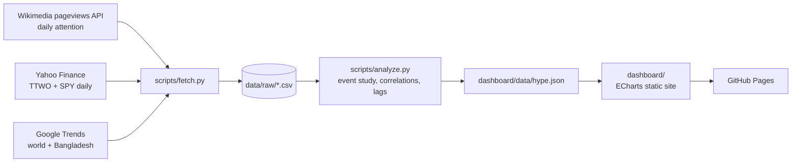

# Leonida Hype Index

**The question.** Grand Theft Auto VI took 13 years, set YouTube records with every trailer and finally launched on
19 November 2026. Did all that hype actually move Take-Two Interactive's share price, or did fans and investors
care about different things?

**The answer.** Trailers move eyeballs, not the stock. Delays move the stock. Day to day, hype goes with *how much*
Take-Two trades, not *which way* the price goes. See the [live dashboard](https://zubayerojhor.github.io/leonida-hype-index/).

All data is real and public. Nothing is simulated.

## What the data says

| | |
|---|---|
| Trailer days (4 reveals) | Attention 8–11× normal, yet TTWO beat the market by only **+1.2%** on average |
| Delay days (2 delays) | TTWO fell about **8% vs the market** each time, on 4–5× normal volume |
| Review day (18 Nov 2026, Metacritic 99) | Attention 20× normal, TTWO **+6.5%** vs the market |
| Launch day (19 Nov 2026) | TTWO **−2.6%** vs the market: sell the news |
| Control event (Google Project Genie, 30 Jan 2026) | TTWO **−7.8%** with *no* rise in GTA attention: the stock moves for reasons hype can't see |
| Attention vs price, raw levels | r = 0.06 (Spearman 0.30). Two drifting series, unreliable |
| Daily attention change vs daily return | r = −0.02. No directional link |
| Attention surprise vs volume surprise | **r = 0.33** (0.19 with all event days removed). The real link |
| Who moves first? | Same day. A slight tilt to attention leading by one day, too small to trade on |
| Bangladesh | #58 of 65 countries for search interest, but trailers hit **2.5–3.7× harder** here relative to launch week than worldwide |

## How it is built



**Event study.** For each GTA moment the expected TTWO return comes from a market model (TTWO regressed on SPY)
fitted on trading days −130 to −10, so the event never contaminates its own baseline. Abnormal return = actual −
expected, on the first trading day the market could react (news after the close counts the next day).

**Correlation without the trend trap.** Attention and price both drift over three years, so raw levels can show
a link that isn't there (or hide one that is). The dashboard instead correlates *surprises*: the log of today's
value minus its trailing baseline (30-day median for attention, 60-day mean for volume).

**Lead/lag.** Correlation of today's attention surprise with volume surprise *k* days later, for k = −5…+5.

**Wanted level.** TTWO's 20-day volatility, ranked against its own 2023–26 history (5 stars = top 5%).

## Run it yourself

```bash
pip install -r requirements.txt
python scripts/fetch.py      # downloads raw data to data/raw/
python scripts/analyze.py    # writes dashboard/data/hype.json and prints the results
python -m http.server 8000 --directory dashboard
```

Google Trends is rate limited. If it refuses, `fetch.py` keeps the previous Trends files and carries on
(`--no-trends` skips it). A GitHub Action refreshes the data every day and redeploys the page.

## Caveats

- About ten events. The averages are stories, not laws.
- Correlation is not causation. Earnings news and hype often land on the same day.
- Wikipedia attention skews to English-reading audiences. Google Trends values are indexed, not counts.
- Launch sales ($1.84B, ~19M copies) are Sensor Tower estimates quoted by the press, not Take-Two figures.

## Disclaimer

Fan-made data project. Not affiliated with or endorsed by Rockstar Games or Take-Two Interactive. Grand Theft Auto
and GTA are their trademarks. No game assets are used. Nothing here is investment advice.

## License

MIT
