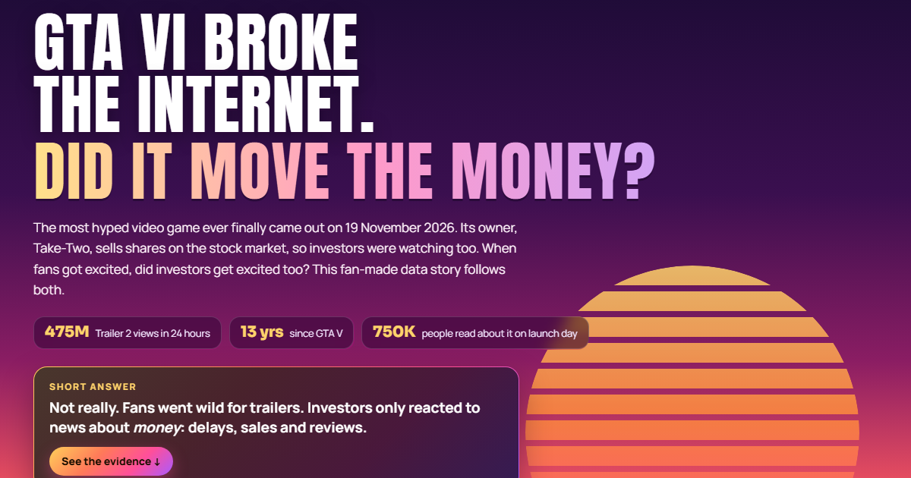
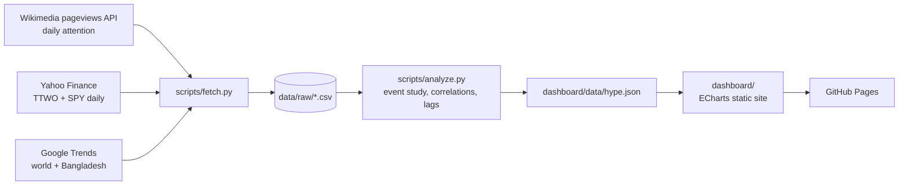

# GTA VI: Hype vs Money

*The Leonida Hype Index: a fan-made data story.*



**The question.** GTA VI is the most hyped video game ever made. It finally came out on 19 November 2026.
The company that owns its maker, Rockstar Games, is Take-Two Interactive, and anyone can buy its shares on the US
stock market (code TTWO). So: when fans got excited, did investors get excited too?

**The short answer.** Not really. Fans went wild for trailers. Investors only reacted to news about *money*:
delays, sales and reviews. See the [live dashboard](https://zubayerojhor.github.io/leonida-hype-index/).

All data is real and public. Nothing is simulated.

## What the data says, in plain words

"Vs the market" means Take-Two's move with the whole stock market's move (the S&P 500) taken out, so only the
GTA part is left.

| Moment | What happened |
|---|---|
| Trailer days (4 big reveals) | 8–11× more people than usual read about GTA VI, yet the shares did only **1.2% better** than the market on average |
| Delay days (2 delays) | Shares fell about **8% vs the market** each time. The second delay wiped roughly $3 billion off Take-Two's value |
| Review day (18 Nov 2026, 99/100) | Shares **+6.5%** vs the market |
| Launch day (19 Nov 2026) | The most interest ever (750k Wikipedia readers in a day), yet shares **−2.6%** vs the market: investors took profits |
| A dull results day (7 Feb 2025) | Take-Two just said "still on schedule": **+14.8%**, the biggest jump of all |
| Not-GTA comparison (Google AI tool, 30 Jan 2026) | Shares **−7.8%** with no change in GTA interest: shares also move for reasons hype can't see |
| The big picture | From Trailer 1 to launch, Take-Two's shares rose **33%**; the whole market rose **63%** |

Across all ~740 trading days:

| Question | Answer |
|---|---|
| More interest → shares go up? | **No link** (r = −0.02) |
| More interest → more shares traded? | **Moderate link** (r = 0.34; still 0.19 with every big GTA day removed) |
| Just compare the two lines over three years? | **Misleading**: both drift upwards, and two standard methods give 0.04 vs 0.30 |
| Which comes first? | Same day. Hype is very slightly ahead, too little to matter |
| Bangladesh | Around #60 of ~65 countries for "GTA 6" searches, but compared with launch week, trailers hit Bangladesh about **2.5–4× harder** than the world. Bangladesh watched the trailers; the world bought the game |

## How it is built



**Event study.** For each GTA moment the expected TTWO return comes from a market model (TTWO regressed on SPY)
fitted on trading days −130 to −10, so the event never contaminates its own baseline. Abnormal return = actual −
expected, on the first trading day the market could react (news after the close counts the next day).

**Correlation without the trend trap.** Attention and price both drift over three years, so raw levels can show
a link that isn't there (or hide one that is). The dashboard instead correlates *surprises*: the log of today's
value minus its trailing baseline (30-day median for attention, 60-day mean for volume).

**Lead/lag.** Correlation of today's attention surprise with volume surprise *k* days later, for k = −5…+5.

**Wanted level.** TTWO's 20-day volatility, ranked against its own 2023–26 history (5 stars = top 5%).

## Run it yourself

```bash
pip install -r requirements.txt
python scripts/fetch.py      # downloads raw data to data/raw/
python scripts/analyze.py    # writes dashboard/data/hype.json and prints the results
python -m http.server 8000 --directory dashboard
```

Google Trends is rate limited. If it refuses, `fetch.py` keeps the previous Trends files and carries on
(`--no-trends` skips it). A GitHub Action refreshes the data every day and redeploys the page.

## Caveats

- About ten events. The averages are stories, not laws.
- Correlation is not causation. Earnings news and hype often land on the same day.
- Wikipedia attention skews to English-reading audiences. Google Trends values are indexed, not counts.
- Launch sales ($1.84B, ~19M copies) are Sensor Tower estimates quoted by the press, not Take-Two figures.

## Disclaimer

Fan-made data project. Not affiliated with or endorsed by Rockstar Games or Take-Two Interactive. Grand Theft Auto
and GTA are their trademarks. No game assets are used. Nothing here is investment advice.

## License

MIT
