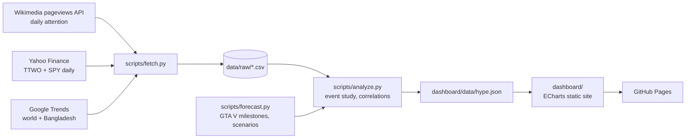

# GTA VI: Did It Print Money?

*The Leonida Hype Index: a fan-made data story.*


**The question.** Everyone said GTA VI would print money. It finally came out on 19 November 2026, after 13 years
and record-breaking trailers. Is the money actually there, and what did the stock market think?

**The short answer.** Yes. About **$2.36 billion on day one** (Sensor Tower estimate), three times GTA V's first day
and more than investors asked for. If it keeps selling like GTA V did, copies alone could bring in **$6–12 billion by
2035**. The twist: the owner's share price barely moved, because investors had already bet on it.
See the [live dashboard](https://zubayerojhor.github.io/leonida-hype-index/).

The money figures are press-reported estimates; Take-Two hasn't published official GTA VI sales yet. Everything else
is real public data. Nothing is simulated.

## What the data says, in plain words

### The money

| | |
|---|---|
| GTA VI, day one (incl. pre-orders) | ~$2.36B and ~24.5M copies (Sensor Tower, via BBC / The Business Standard) |
| GTA V, day one (2013) | ~$0.8B and 11.2M copies |
| What investors wanted (Bank of America) | ~$1.9B |
| Reported cost to make GTA VI | over $1B, earned back on day one |
| Niko Partners, all of 2026 | more than $3B |

### 2026–2035: three paths

Each path starts from GTA VI's real first day, then adds the copies GTA V sold after its own launch, at the same age
(from Take-Two's reported totals: 11M on day one in 2013, 230M by 2026), times a factor. Money per copy falls from
~$80 to ~$30 as the game ages. Copies only: online-mode earnings aren't published, so they're left out.

| Path | Rule | Copies by 2035 | Money by 2035 |
|---|---|---|---|
| Low | 0.6× GTA V's after-launch sales (pre-orders pulled buyers forward; console-only for now) | ~120M | ~$6.4B |
| Middle | Same as GTA V after launch | ~183M | ~$9.1B |
| High | 1.4× (bigger player base, PC version, online mode) | ~246M | ~$11.8B |

This is a scenario, not a forecast anyone can promise. It will be updated when Take-Two reports real sales.

### What the stock market thought

"Vs the market" means Take-Two's move with the whole stock market's move (the S&P 500) taken out.

| Moment | What happened |
|---|---|
| Trailer days (4 big reveals) | 8–11× more people than usual read about GTA VI, yet the shares did only **1.2% better** than the market |
| Delay days (2 delays) | Shares fell about **8% vs the market** each time; the second wiped roughly $3 billion off Take-Two's value |
| Review day (18 Nov 2026, 99/100) | **+6.5%** vs the market |
| Launch day (19 Nov 2026) | Record interest (750k Wikipedia readers), yet **−2.6%**: investors took profits |
| A dull results day (7 Feb 2025) | "Still on schedule": **+14.8%**, the biggest jump of all |
| Big picture | From Trailer 1 to launch, Take-Two's shares rose **33%**; the whole market rose **63%** |

Across all ~740 trading days, more interest in GTA did **not** mean the price went up (r ≈ 0), but it did mean
**busier trading** (2–5× more shares changed hands on big GTA days).

### Bangladesh

Bangladesh ranks around #60 of ~65 countries for "GTA 6" searches. But compared with launch week, the trailers were
2.5–4× bigger here than worldwide, while pre-order week was smaller. Bangladesh watched the trailers; the world bought
the game.

## How it is built



**Event study.** For each GTA moment the expected TTWO return comes from a market model (TTWO regressed on SPY)
fitted on trading days −130 to −10. Abnormal return = actual − expected, on the first trading day the market could
react (news after the close counts the next day).

**Correlation without the trend trap.** Attention and price both drift over three years, so raw levels mislead. The
analysis correlates *surprises*: the log of today's value minus its trailing baseline.

**Scenarios.** `scripts/forecast.py` holds GTA V's milestones, the scenario factors and the price-per-copy
assumptions, so every number on the page can be traced and changed.

## Run it yourself

```bash
pip install -r requirements.txt
python scripts/fetch.py      # downloads raw data to data/raw/
python scripts/analyze.py    # writes dashboard/data/hype.json and prints the results
python -m http.server 8000 --directory dashboard
```

Google Trends is rate limited. If it refuses, `fetch.py` keeps the previous Trends files (`--no-trends` skips it).
A GitHub Action refreshes the data every weekday and redeploys the page.

## Caveats

- Sales are estimates and they move: $1.84B on launch day became $2.36B a day later.
- The 2026–2035 numbers follow GTA V's history; GTA VI may not.
- Only about ten big GTA moments, so the stock averages are a story, not a law.
- Correlation is not causation. Wikipedia attention skews to English readers; Google Trends values are indexed.

## Disclaimer

Fan-made data project. Not affiliated with or endorsed by Rockstar Games or Take-Two Interactive. Grand Theft Auto
and GTA are their trademarks. No game assets are used. Nothing here is investment advice.

## License

MIT
